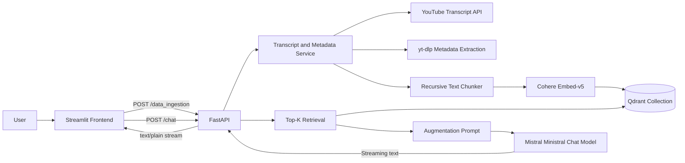

# PodcastIQ

PodcastIQ is a full-stack Retrieval-Augmented Generation (RAG) application that turns YouTube videos into searchable conversational knowledge. The application extracts a video's transcript and metadata, splits the transcript into searchable chunks, stores embeddings in Qdrant, and streams context-grounded answers through a FastAPI backend to a Streamlit interface.

[](https://www.python.org/)
[](https://fastapi.tiangolo.com/)
[](https://streamlit.io/)
[](https://python.langchain.com/)
[](https://qdrant.tech/)

---

## Table of Contents

- [Features](#features)
- [How It Works](#how-it-works)
- [Architecture](#architecture)
- [Technology Stack](#technology-stack)
- [Project Structure](#project-structure)
- [Prerequisites](#prerequisites)
- [Environment Configuration](#environment-configuration)
- [Installation](#installation)
- [Running the Application](#running-the-application)
- [API Reference](#api-reference)
- [Data and Processing](#data-and-processing)
- [Configuration Reference](#configuration-reference)
- [Development](#development)
- [Operational Notes](#operational-notes)
- [Troubleshooting](#troubleshooting)
- [Limitations and Known Considerations](#limitations-and-known-considerations)
- [Security](#security)
- [Contributing](#contributing)
- [License](#license)

---

## Features

- YouTube URL ingestion for standard watch URLs, short URLs, Shorts, and embed URLs
- Video metadata extraction including title, channel, description, upload date, duration, and engagement fields
- Transcript retrieval in English, Hindi, and Marathi where those transcripts are available
- Semantic chunking with overlap and source metadata preservation
- Video-specific Qdrant collections
- Cohere vector embeddings
- Mistral-hosted chat generation
- Streaming responses with incremental Streamlit rendering
- Transcript-grounded answers with an explicit “not available in context” fallback
- Per-video collection deletion when a user processes another video
- Streamlit health-check and user-friendly API error handling

---

## How It Works



1. The user submits a YouTube URL.
2. PodcastIQ extracts the video ID and calls `yt-dlp` for metadata.
3. `YouTubeTranscriptApi` retrieves an available transcript in the configured language preference.
4. The transcript is split into chunks of approximately 800 characters with 120 characters of overlap.
5. Chunk text and metadata are embedded with Cohere `embed-v5.0-fast`.
6. Chunks are stored in a Qdrant collection named after the YouTube video ID.
7. A chat request retrieves the six most relevant chunks.
8. The video metadata and transcript chunks are inserted into the RAG prompt.
9. Mistral `ministral-3b-2512` generates a streamed, context-grounded answer.

---

## Architecture

### Backend

The FastAPI backend exposes health, ingestion, chat, and collection-cleanup endpoints. API routes delegate to service modules rather than implementing transcript, retrieval, or model logic directly.

| Module | Responsibility |
|---|---|
| `backend/main.py` | FastAPI application setup and router registration |
| `backend/api/ingestion.py` | Validates and starts YouTube ingestion |
| `backend/api/chat.py` | Streams RAG responses |
| `backend/api/clean_collection.py` | Deletes a video's vector collection |
| `backend/schemas/*.py` | Pydantic request models and LangChain prompt |
| `backend/model/all.py` | Cohere embedding and Mistral chat model initialization |
| `backend/services/transcript_service.py` | URL parsing, metadata extraction, and transcript loading |
| `backend/services/chunking_service.py` | Recursive text splitting |
| `backend/services/vector_service.py` | Qdrant collection management and document scrolling |
| `backend/services/ingestion_service.py` | Coordinates the ingestion pipeline |
| `backend/services/retrieval_service.py` | Formats retrieval context and builds the RAG chain |
| `backend/services/generation_service.py` | Streams generated answers |

### Frontend

The Streamlit frontend at `frontend/app.py` maintains transient session state for:

- the active YouTube URL;
- the active video ID;
- displayed chat history.

It sends API requests synchronously to FastAPI and consumes the chat endpoint as a byte/text stream.

---

## Technology Stack

| Area | Technology |
|---|---|
| Language | Python 3.12 |
| Backend | FastAPI, Uvicorn |
| Frontend | Streamlit |
| RAG framework | LangChain |
| Embeddings | Cohere `embed-v5.0-fast` |
| Chat model | Mistral `ministral-3b-2512` |
| Vector database | Qdrant |
| YouTube metadata | `yt-dlp` |
| YouTube transcripts | `youtube-transcript-api` |
| Environment management | python-dotenv |
| Dependency management | uv |
| Data models | Pydantic |

---

## Project Structure

```text
PodcastIQ/
├── backend/
│   ├── api/
│   │   ├── chat.py
│   │   ├── clean_collection.py
│   │   └── ingestion.py
│   ├── model/
│   │   └── all.py
│   ├── schemas/
│   │   ├── chat.py
│   │   └── ingestion.py
│   ├── services/
│   │   ├── chunking_service.py
│   │   ├── generation_service.py
│   │   ├── ingestion_service.py
│   │   ├── retrieval_service.py
│   │   ├── transcript_service.py
│   │   └── vector_service.py
│   └── main.py
├── frontend/
│   └── app.py
├── .env
├── .gitignore
├── .python-version
├── pyproject.toml
├── uv.lock
└── README.md
```

---

## Prerequisites

- Windows 10/11, macOS, or Linux
- Python 3.12
- [uv](https://docs.astral.sh/uv/) for dependency and environment management
- Internet access
- A Cohere API key
- A Mistral API key
- A Qdrant deployment or Qdrant Cloud cluster
- Public availability of the target YouTube video's transcript

Verify the local tools:

```powershell
python --version
uv --version
```

---

## Environment Configuration

Create `.env` in the repository root. Never commit real API keys.

```dotenv
QUDRANT_URL=https://your-qdrant-cluster.example.com
QUDRANT_API_KEY=replace-with-your-qdrant-key
MISTRAL_API_KEY=replace-with-your-mistral-key
COHERE_API_KEY=replace-with-your-cohere-key
```

> [!IMPORTANT]
> The Qdrant environment variable name is currently spelled `QUDRANT_URL` and `QUDRANT_API_KEY` in the source code. Use that spelling until the implementation is corrected.

The provider SDKs read their API keys from the environment. `FREETRANSCRIPT_API_KEY` is not referenced by the current source and is optional.

### Qdrant

- `QUDRANT_URL`: Qdrant HTTP/HTTPS endpoint
- `QUDRANT_API_KEY`: API key for hosted Qdrant

The application creates a collection dynamically for each video:

- collection name: YouTube video ID;
- vector size: `2048`;
- similarity distance: cosine.

The configured vector size must match the output size of the selected embedding model.

---

## Installation

### 1. Clone the repository

```powershell
git clone https://github.com/Rushikesh802/PodcastIQ.git
cd PodcastIQ
```

### 2. Install dependencies

```powershell
uv sync
```

`uv` uses `.python-version` and `pyproject.toml` to select Python 3.12 and reproduce dependencies from `uv.lock`.

### 3. Configure environment variables

Create `.env` as described above.

---

## Running the Application

Start the FastAPI backend:

```powershell
uv run uvicorn backend.main:app --reload
```

FastAPI defaults to `http://127.0.0.1:8000`.

Open a second terminal and start Streamlit:

```powershell
uv run streamlit run frontend/app.py
```

Streamlit defaults to `http://localhost:8501`.

Optional interactive API documentation:

- Swagger UI: <http://127.0.0.1:8000/docs>
- ReDoc: <http://127.0.0.1:8000/redoc>

### Windows virtual environment alternative

If you need to activate the environment directly:

```powershell
.venv\Scripts\Activate.ps1
uvicorn backend.main:app --reload
```

Use a separate terminal for Streamlit.

---

## API Reference

### Health check

```http
GET /
GET /health
```

Example:

```powershell
curl.exe http://127.0.0.1:8000/health
```

Response:

```json
{
  "message": "API working fine",
  "status": "healthy"
}
```

### Ingest a YouTube video

```http
POST /data_ingestion
Content-Type: application/json
```

Request:

```json
{
  "url": "https://www.youtube.com/watch?v=VIDEO_ID"
}
```

Example:

```powershell
curl.exe -X POST "http://127.0.0.1:8000/data_ingestion" `
  -H "Content-Type: application/json" `
  -d '{\"url\":\"https://www.youtube.com/watch?v=VIDEO_ID\"}'
```

Success response:

```json
{
  "success": true,
  "message": "Data ingestion successfully completed!",
  "video_id": "VIDEO_ID"
}
```

Status codes:

- `201 Created`: ingestion completed;
- `400 Bad Request`: invalid or unsupported URL/transcript data;
- `422 Unprocessable Entity`: invalid Pydantic request body;
- `500 Internal Server Error`: unexpected backend failure.

### Ask a question

```http
POST /chat
Content-Type: application/json
Accept: text/plain
```

Request:

```json
{
  "query": "What are the main topics discussed?",
  "video_id": "VIDEO_ID"
}
```

The response is a streamed plain-text HTTP response. Both `query` and `video_id` must be non-empty strings.

### Delete a video's collection

```http
DELETE /delete?video_id=VIDEO_ID
```

Example:

```powershell
curl.exe -X DELETE "http://127.0.0.1:8000/delete?video_id=VIDEO_ID"
```

Deleting a collection removes all stored chunks and embeddings for that video.

---

## Data and Processing

### Supported URL formats

- `https://www.youtube.com/watch?v=<id>`
- `https://youtu.be/<id>`
- `https://www.youtube.com/shorts/<id>`
- `https://www.youtube.com/embed/<id>`

### Chunking

The recursive character splitter uses:

| Setting | Value |
|---|---:|
| Chunk size | 800 characters |
| Chunk overlap | 120 characters |
| Start index | enabled |

The original metadata and source URL are retained on each generated document.

### Retrieval

Chat retrieval uses:

- video-specific collection;
- cosine similarity;
- top `k = 6` chunks.

The response is generated only from the combined metadata and retrieved transcript context.

### Transcript availability

The transcript service requests these language preferences:

- `en`
- `hi`
- `mr`
- `en-US`
- `en-GB`
- `hi-IN`
- `mr-IN`

Availability depends on the source video and YouTube's transcript offerings.

---

## Configuration Reference

| Setting | Location | Default / Source |
|---|---|---|
| Python | `.python-version`, `pyproject.toml` | 3.12 |
| API title | `backend/main.py` | PodcastIQ |
| API version | `backend/main.py` | 1.0.0 |
| Backend URL | `frontend/app.py` | `http://127.0.0.1:8000` |
| Streamlit layout | `frontend/app.py` | centered |
| Embedding model | `backend/model/all.py` | Cohere `embed-v5.0-fast` |
| Chat model | `backend/model/all.py` | Mistral `ministral-3b-2512` |
| Chunk size | `backend/services/chunking_service.py` | 800 |
| Chunk overlap | `backend/services/chunking_service.py` | 120 |
| Retrieved chunks | `backend/services/retrieval_service.py` | 6 |
| Qdrant collection vector size | `backend/services/vector_service.py` | 2048 |
| Qdrant distance metric | `backend/services/vector_service.py` | cosine |

---

## Development

### Run the backend in development mode

```powershell
uv run uvicorn backend.main:app --reload
```

### Run the frontend

```powershell
uv run streamlit run frontend/app.py
```

### Add a dependency

```powershell
uv add <package-name>
```

### Synchronize an existing lockfile

```powershell
uv sync
```

### Inspect installed packages

```powershell
uv pip list
```

### Suggested validation

No automated test suite is currently included. Before submitting changes, at minimum:

1. start FastAPI and verify `/health`;
2. ingest a video with an available transcript;
3. ask a question covered by that transcript;
4. verify streaming completes without errors;
5. delete the video collection and confirm cleanup;
6. test invalid URLs and missing transcripts.

---

## Operational Notes

- Ingestion can take several minutes for long videos or slow external services.
- The frontend sets 600-second read/write timeout allowances for ingestion.
- The frontend allows 180 seconds for the chat stream to begin.
- Qdrant collection creation and document indexing are synchronous during ingestion.
- Re-ingesting the same video writes another set of documents unless the existing collection is cleaned or deduplicated first.
- Streamlit chat history is in-memory and resets on a frontend process restart.
- Model initialization occurs at module import time and requires provider credentials.
- API and model exceptions are logged on the backend; returned details are intentionally limited.

---

## Troubleshooting

### Backend is not connected

- Start FastAPI before Streamlit.
- Confirm `http://127.0.0.1:8000/health` responds.
- Ensure port `8000` is not blocked or in use.

### Missing environment variables

Verify `.env` contains all provider and Qdrant variables. The process must be started from a directory where python-dotenv can discover the repository `.env`, or use an explicitly configured environment.

### Invalid YouTube URL

Use a full watch, short, Shorts, or embed URL. Private, restricted, live, or region-blocked videos may not expose metadata or transcripts.

### Transcript unavailable

Some videos disable transcripts or do not provide transcripts in the configured languages. Try another public video or add a valid language preference in `transcript_service.py`.

### Qdrant connection failure

- Verify `QUDRANT_URL` is a reachable HTTPS/HTTP endpoint.
- Verify `QUDRANT_API_KEY` is valid.
- Confirm collection creation permissions.
- Check Qdrant logs or cloud cluster status.

### Cohere or Mistral authentication failure

- Verify `COHERE_API_KEY` and `MISTRAL_API_KEY`.
- Confirm the keys are active and have access to the configured models.
- Check provider quota and rate limits.

### Wrong or vector-size mismatch

The collection is configured for 2048-dimensional vectors. If switching embedding models, update `VectorParams.size` and recreate existing collections.

### Port already in use

Use alternative ports:

```powershell
uv run uvicorn backend.main:app --reload --port 8001
uv run streamlit run frontend/app.py --server.port 8502
```

Update `URL` in `frontend/app.py` if the backend port changes.

---

## Limitations and Known Considerations

- The application has no durable user or chat session database.
- Authentication and authorization are not implemented.
- There is no asynchronous ingestion queue or background worker.
- Re-ingestion does not deduplicate existing chunks.
- Chat answers do not currently include transcript timestamps or citation spans.
- Retrieval quality depends on the configured chunk size and Cohere embeddings.
- The system does not verify legal rights or licenses for ingested YouTube content.
- The source code contains a Qdrant environment-variable spelling inconsistency (`QUDRANT_*`) that should be aligned to `QDRANT_*`.
- No automated test suite, lint configuration, or CI workflow is currently included.
- The FastAPI Cloud metadata directory is local deployment metadata and should not be committed.

---

## Security

- Never commit `.env`, provider keys, or Qdrant credentials.
- Rotate credentials immediately if they appear in logs or version control.
- Restrict FastAPI endpoints with authentication and authorization before public deployment.
- Add request size, rate, and timeout limits for production use.
- Sanitize and validate all external URLs and model outputs.
- Store `FREETRANSCRIPT_API_KEY` or provider credentials only in a secret manager in hosted environments.
- Delete collections when a video's data is no longer required.

---

## Contributing

1. Create a focused feature branch.
2. Preserve the existing service-oriented structure.
3. Keep secrets out of source control.
4. Add or update tests for behavior changes.
5. Run backend and frontend smoke tests.
6. Open a pull request with setup and validation details.

---

## License

No license file is currently included in the repository. If this project is intended for public distribution or collaboration, add an appropriate `LICENSE` file and update this section.
